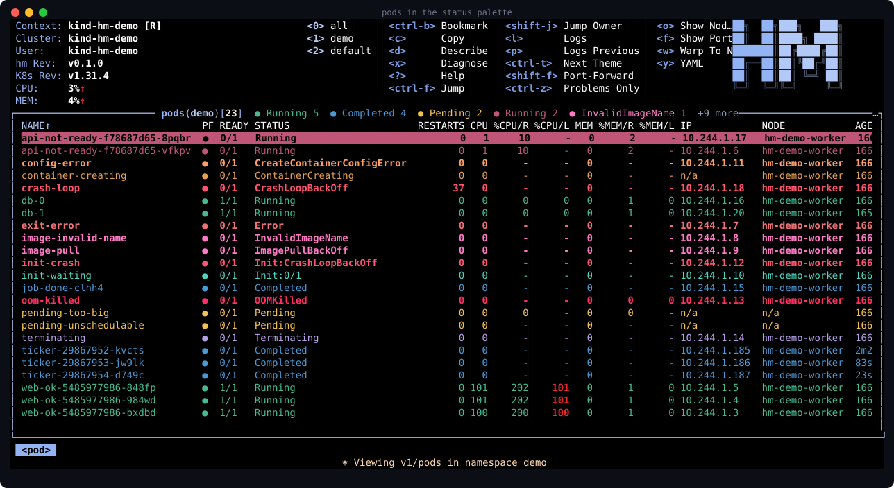
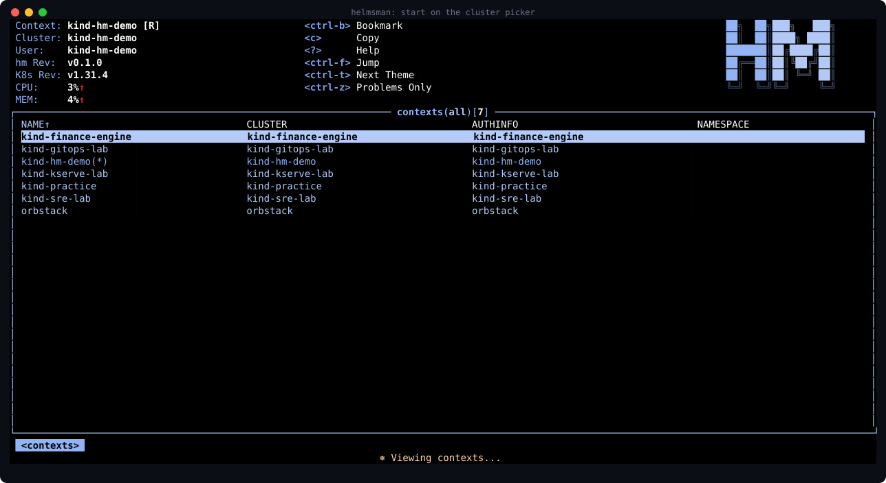
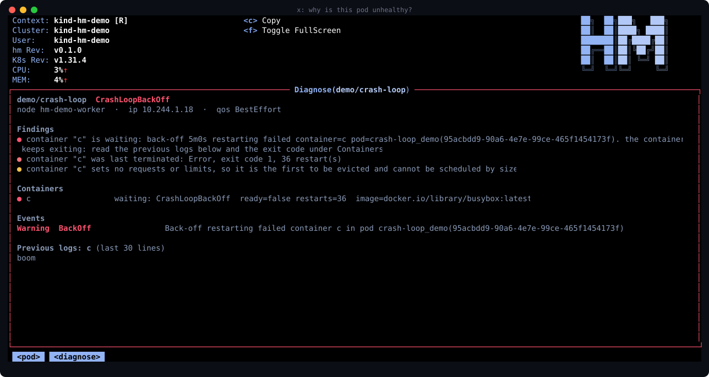
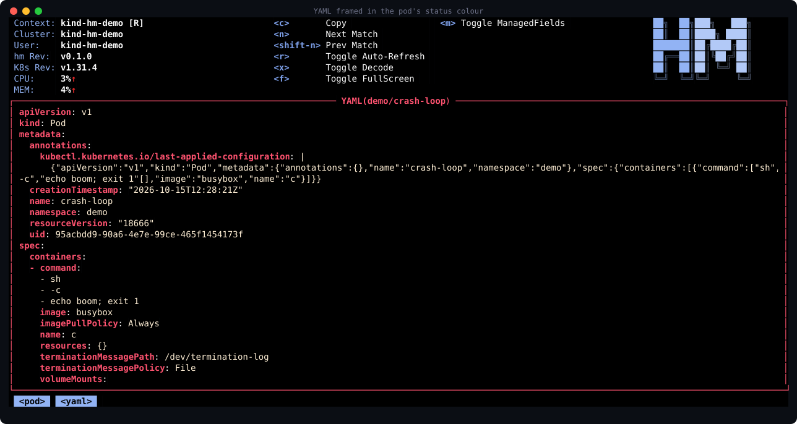
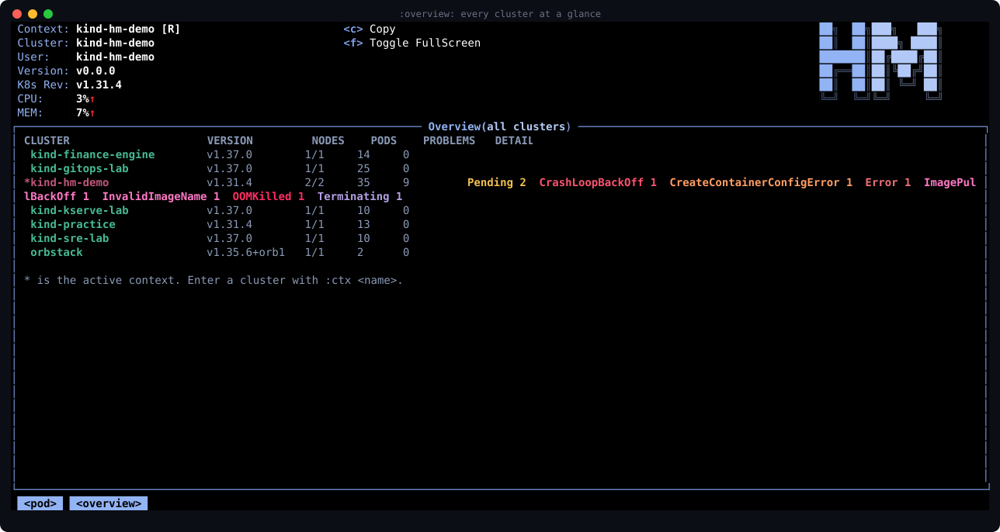
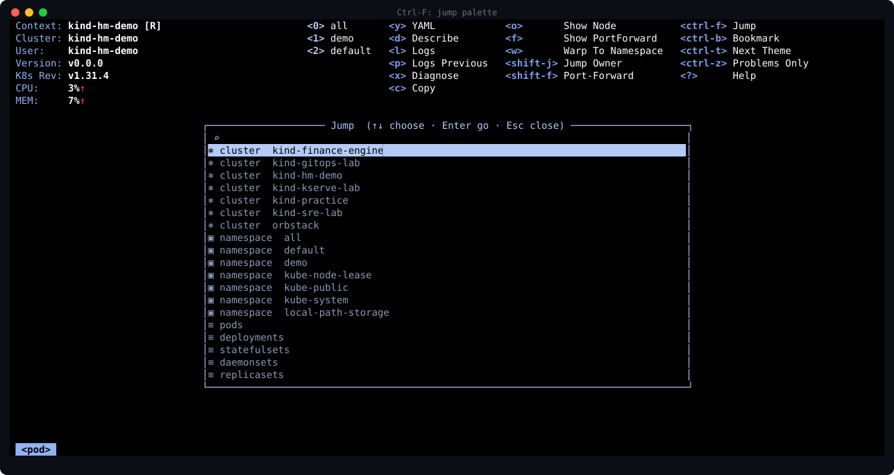
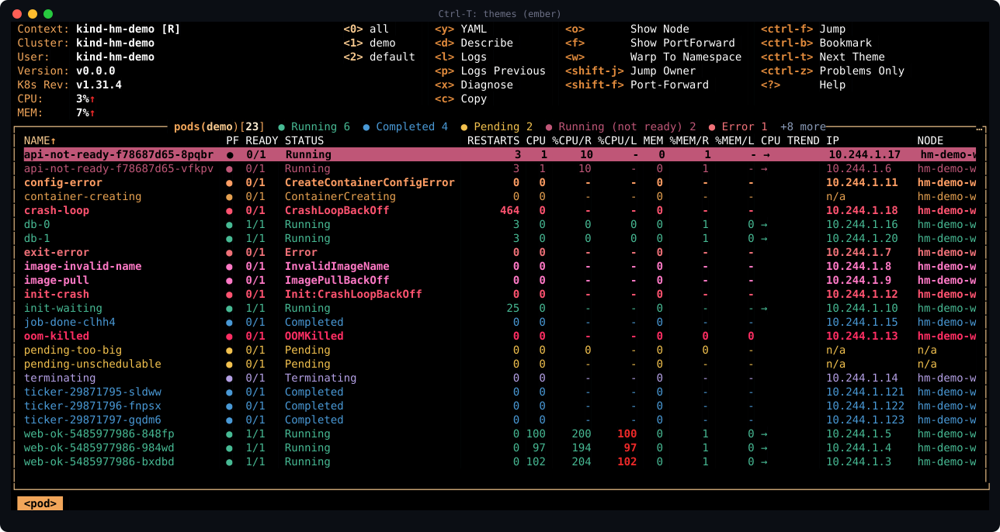
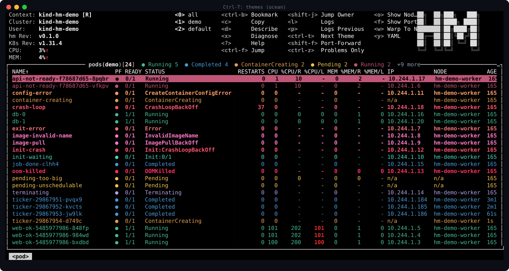

<h1 align="center">helmsman</h1>

<p align="center"><b>A terminal UI for Kubernetes that tells you what is wrong before you read a single line.</b></p>

<p align="center">
  
</p>

`helmsman` starts where you actually start: on a **cluster picker**. Pick a cluster, pick a namespace,
land in its pods. `Esc` walks back one level at a time. Every status has its own colour, healthy pods
fade into the background, and anything broken is loud.

> Status: early development (`v0.1.0`). Expect rough edges.

## See it

The animation above is a real recording (`docs/demo.cast`, play it with `asciinema play`). The stills
below are rendered from the real program too, see [Development](#development).

**Pods in a status palette.** Healthy is green, finished is blue, waiting is amber, broken is red or
pink, failing rows are bold. The table title counts pods per status.

<p align="center"></p>

**Start on a cluster, not on a guess.** Clusters, then namespaces, then pods.

<p align="center"></p>

**Why is this pod broken?** Press `x`. Findings with advice, every container's state, the latest events
and the tail of the previous logs, on one screen.

<p align="center"></p>

**YAML, describe and logs wear the pod's colour.** The frame, title and keys follow the pod's status.

<p align="center"></p>

**Every cluster at a glance.** `:overview` lists every kubeconfig context with version, nodes, pods and
what is wrong.

<p align="center"></p>

**Jump anywhere.** `Ctrl-F` is a fuzzy palette over bookmarks, clusters, namespaces and resources.

<p align="center"></p>

**Themes.** `Ctrl-T` cycles eight of them.

<p align="center">
  
  
</p>

## Install

You need a kubeconfig (anything `kubectl` can use). Then pick one way.

### With Go (recommended)

```sh
go install github.com/rsmrtk/helmsman@latest
```

That puts a `helmsman` binary in `$(go env GOPATH)/bin`. If typing `helmsman` says *command not found*,
add that directory to your `PATH`:

```sh
export PATH="$PATH:$(go env GOPATH)/bin"     # add this line to ~/.zshrc or ~/.bashrc
```

### From source

```sh
git clone https://github.com/rsmrtk/helmsman.git
cd helmsman
make install                    # builds and copies helmsman to ~/.local/bin
# or choose where it goes:  make install INSTALL_DIR=/usr/local/bin
```

`~/.local/bin` must be on your `PATH` (it is on most Linux distributions; on macOS add
`export PATH="$HOME/.local/bin:$PATH"` to `~/.zshrc`).

### Homebrew

A tap is not published yet. When it is, this will work:

```sh
brew install rsmrtk/tap/helmsman
```

The formula lives in [`docs/homebrew/helmsman.rb`](docs/homebrew/helmsman.rb) with instructions for filling it
in from a release.

### Prebuilt binaries

Download the archive for your system from the
[Releases](https://github.com/rsmrtk/helmsman/releases) page, unpack it and put `helmsman` somewhere on
your `PATH`.

### Run it

```sh
helmsman
```

There is nothing to set up. helmsman reads the same kubeconfig as `kubectl` (`$KUBECONFIG`, or
`~/.kube/config`), so every cluster `kubectl` can reach is already on the cluster picker: kind, minikube,
k3d, Docker Desktop, OrbStack, and EKS/GKE/AKS once their credentials are in the kubeconfig
(`:cloud import <cluster>` does that for you). A cluster added while helmsman is open appears within a few
seconds. With no cluster at all, helmsman opens a short screen that says how to get one.

Check the install with `helmsman version`. A Go toolchain (see `go.mod` for the version) is only needed to
build; running needs nothing else.

## Using it

```sh
helmsman                          # start on the cluster picker
helmsman -c pods                  # start directly in a resource view
helmsman --context prod -n web -c pods
```

| Key | Action |
| --- | --- |
| `Esc` | back one level |
| `Ctrl-F` | jump palette (bookmarks, clusters, namespaces, resources) |
| `Ctrl-B` | bookmark / un-bookmark the current place |
| `Ctrl-T` | next theme |
| `Ctrl-Z` | problems only |
| `x` | diagnose the selected pod; the view refreshes itself, `r` restarts the pod (with confirmation, not in `--readonly`) |
| `y` `d` `l` | YAML / describe / logs of the selected row |
| `c` | copy the selected name |
| `?` | every key for the current view |
| `:` | command prompt |

Commands you can type after `:`

| Command | What it does |
| --- | --- |
| `:ctx`, `:ns`, `:pods`, `:deploy`, … | the usual resource and context commands |
| `:overview` | every kubeconfig context with nodes, pods and problems |
| `:diff <ctx-a> <ctx-b> [namespace]` | workloads and images side by side across two clusters |
| `:gpu` | GPU capacity per node and the pods holding it |
| `:warnings` (`:warn`) | Warning events merged by object and reason, most repeated first |
| `:drift <argo-app> [namespace]` | which resources of an Argo CD application differ from git |
| `:argo`, `:app`, `:isvc` | Argo CD applications, KServe inference services |
| `:cloud` | AWS, GCP and Azure accounts (see below) |

Everything else works as in the engine helmsman is built on, `?` shows it inside the app.

### Trends and fleet screens

- **CPU TREND** column on pods: `→` steady, `↑ +40m` rising, `↓ -25m` falling, compared with the pod's own
  recent average. It fills in while helmsman is open and needs metrics-server (without it the column stays
  empty).
- The hint menu at the top groups keys by what they do (look at a row / change it / app-wide) and shows the
  logo only when the terminal is wide enough for every label.
- `:diff` compares workloads (images and replicas), ConfigMaps, Secrets, Services and Ingresses between two
  clusters. Secret and ConfigMap contents are compared through a short hash and never shown.

### What the colours mean

| Colour | Statuses |
| --- | --- |
| green | Running |
| blue | Completed, Succeeded |
| raspberry | Running but not every container ready |
| amber | Pending, ContainerCreating |
| teal | Init, PodInitializing |
| red / coral | CrashLoopBackOff, OOMKilled, Error |
| pink | ImagePullBackOff, InvalidImageName |
| purple | Terminating |

Deployments, StatefulSets, DaemonSets, ReplicaSets, nodes, PVs, PVCs, namespaces and custom resources
(Argo CD `Synced`/`Degraded`, KServe `Ready`, …) use the same palette. Any colour can be overridden in a
skin:

```yaml
k9s:
  frame:
    status:
      pods:
        CrashLoopBackOff: "#ff5370"
```

### Clouds

`:cloud` reads AWS, GCP and Azure through the CLIs you are already signed in with (`aws`, `gcloud`, `az`).
helmsman stores no credentials.

```
:cloud                              who you are signed in as, per provider
:cloud aws ec2|s3|eks|rds           list resources
:cloud gcp vm|gke|buckets
:cloud azure vm|aks|storage|group
:cloud login aws|gcp|azure          sign in (hands the terminal to the provider's own login)
:cloud import <cluster>             add an EKS, GKE or AKS cluster to your kubeconfig
```

After `:cloud import`, the cluster shows up in `:ctx` and in `Ctrl-F`. GKE also needs
`gke-gcloud-auth-plugin` (`gcloud components install gke-gcloud-auth-plugin`).

### Configuration

Config, skins and bookmarks live in the helmsman config dir (`~/Library/Application Support/helmsman` on
macOS, `~/.config/helmsman` on Linux). Environment variables can be given as `HELMSMAN_<NAME>`
(`CONFIG_DIR`, `LOGS_DIR`, `SKIN`, `EDITOR`, …).

## Privacy

helmsman has no telemetry and does not check for updates. It talks to the clusters in your kubeconfig and,
when you ask for it, to the `aws`, `gcloud` and `az` programs on your machine. The only other network use is
the optional image vulnerability scan, which is off unless you enable it in the config.

## Try it on a cluster full of problems

```sh
./demo/up.sh                                   # kind cluster with pods in every state
helmsman --context kind-hm-demo -c pods -n demo
```

Needs [kind](https://kind.sigs.k8s.io/) and Docker. Remove it with `kind delete cluster --name hm-demo`.

## Development

```sh
go test ./...                                          # unit tests
E2E_CONTEXT=kind-hm-demo go test -tags e2e ./e2e/...   # against the demo cluster (also run in CI)
python3 demo/screenshots.py                            # regenerate the stills above (needs pyte)
python3 demo/record.py && python3 demo/tour_svg.py     # re-record the animated tour
```

## Acknowledgements and license

helmsman is a modified derivative of [k9s](https://github.com/derailed/k9s) by Fernand Galiana and
contributors, and builds on its engine. It is distributed under the [Apache License 2.0](LICENSE), the
same license as k9s. The original copyright notice is kept in [COPYING](COPYING) and [NOTICE](NOTICE).
Changes and additions made in this project are copyright rsmrtk.
